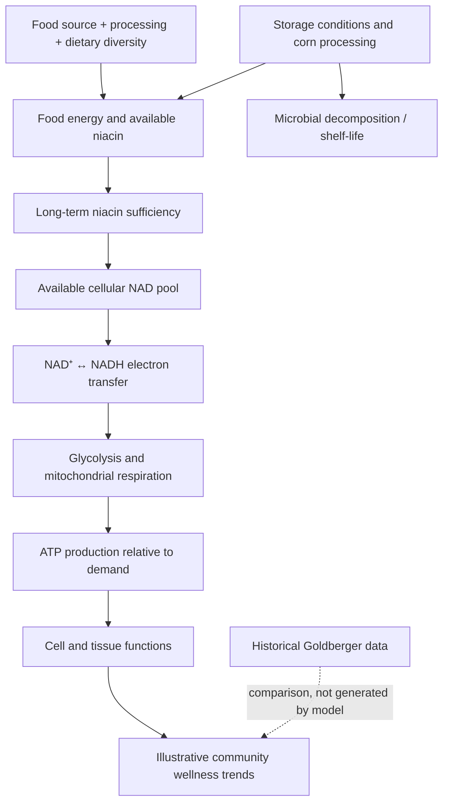
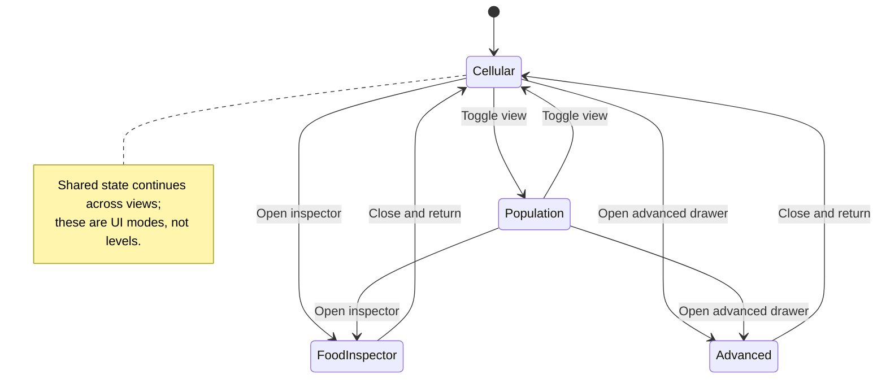
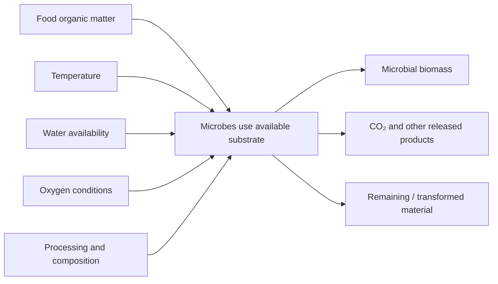
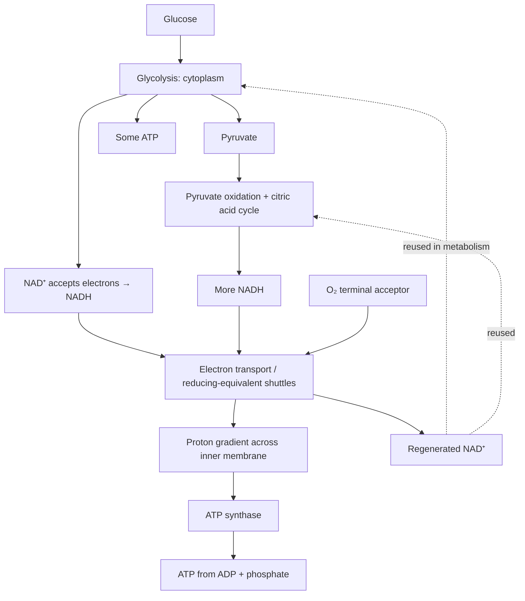
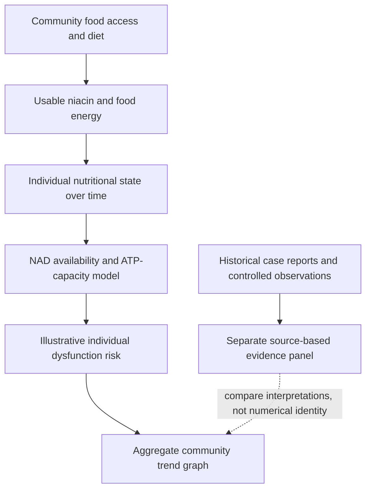
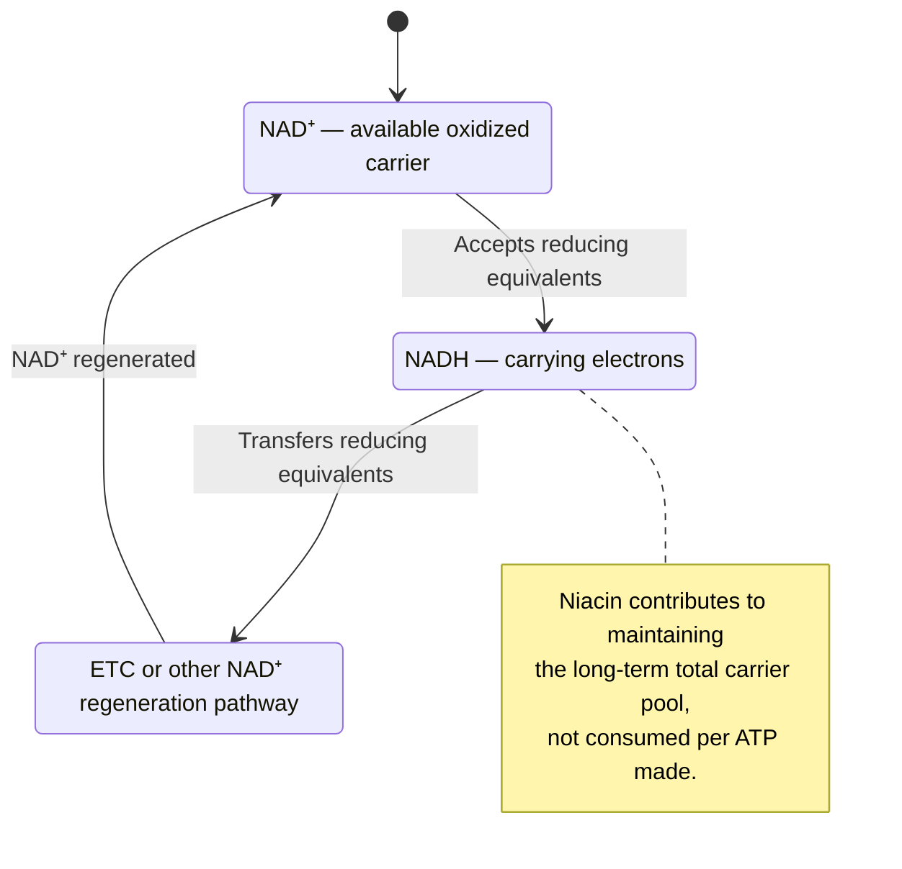

# The Pellagra Mystery: Inside the Cellular Energy Factory

**Game Design Document:** v0.1  
**Curriculum:** New Visions Biology, Unit 5 *Food for All*, Lesson 3 *Infectious Agent or Insufficient Diet 5E* (SY 2026–27)  
**Engine:** Godot 4.7.x / GDScript / 2D / web export  
**Hosting:** `sims.mr-miner.com`  
**Status:** Production-oriented design specification; numerical calibration and acceptance testing remain necessary  
**Primary reference materials:** Teacher Materials; Student Materials; `Sims_Site_Hosting_Requirements.md`  

> **Binding instructional boundary:** This is a supplementary scientific sandbox to use **alongside and within** the existing lesson, **not** a replacement curriculum, independent course, required campaign, or assessment system. The teacher controls when it is used. Do not recreate the 5E sequence as game levels or block free exploration behind tutorials, quizzes, unlocks, or missions.

## 1. Executive Summary & Curriculum Core Objectives

### 1.1 Product vision

**Guiding question:** *How could people have enough food to eat, yet become seriously ill because their cells could not produce enough usable energy?*

One unified sandbox links food processing, niacin availability, NAD⁺/NADH electron carriers, cellular respiration, ATP-dependent cell functions, and long-term population outcomes. Students change variables, observe effects in two selectable viewport scales, and use the observations as **models and evidence for discussion**, not as a substitute for Goldberger's historical investigations or the lesson's readings, videos, discussions, and CER work.

The same scientific state persists when the student switches views. There are **no win conditions, scores, compulsory text entry, mandatory steps, or in-game testing gates**.



### 1.2 Three conceptual pillars

1. **Food processing, decomposition and nutrient retention.** Contrast untreated whole corn, traditional alkaline-cooked **nixtamalized** corn, industrially degermed cornmeal, fortified cornmeal, and nutritionally diverse diets. Show how germ removal can reduce nutrient content and some forms of spoilage; distinguish that from the increase in **niacin bioavailability** resulting from nixtamalization. Moisture, temperature, oxygen and microbial access must remain explicit determinants of decomposition. Do **not** suggest every industrially processed food intrinsically resists decomposition or that microbes simply cannot digest starch.
2. **Niacin–NAD–ATP metabolism.** Show niacin as a precursor supporting NAD pool maintenance. NAD⁺ accepts electrons during metabolic reactions, becomes NADH, and is regenerated following electron transfer. The finite carrier pool is **recycled** rather than consumed for each ATP molecule. Chronic deficiency can reduce NAD availability and ATP-producing capacity despite abundant glucose and oxygen.
3. **Historical and population context.** Model community diets and conditions, contrasting tenant-farming and institutional food environments, traditional nixtamalized corn, diversified diets and fortification. Distinguish calculated **illustrative risk** from **documented historical pellagra cases**. Frame dietary deficiency in the context of income, food access and institutional conditions, not biological stereotypes or a moral judgment about individuals.

### 1.3 Learning objectives

Students will be able to:

- Explain why processing methods can change micronutrient retention, bioavailability and food storage properties.
- Describe NAD⁺/NADH as a recycled electron carrier connecting fuel metabolism and electron transport.
- Predict why added calories or glucose cannot fully remedy prolonged niacin deficiency.
- Relate reduced ATP availability to impairment of energy-intensive cell and tissue functions, without treating every pellagra symptom as a simple one-step effect.
- Use source-based population evidence to distinguish the dietary hypothesis from the infectious hypothesis.
- Connect food environments and nutritional access with community-level health patterns.

**Curriculum alignment:** HS-LS2-3 (including the NYSSLS adaptation), LS1.C, LS2.B, modeling, evidence-based explanation, scale/proportion, energy and matter. **Detailed chemical steps shown as an optional enrichment**, not required memorization under the stated performance expectation.

### 1.4 Scope boundaries

**In scope:** one unified simulation state; cellular primary view; macroscopic/population alternate view; compact food inspection and decomposition panel; optional historic-data display; advanced measurements; responsive and keyboard-accessible 2D web export; short repeatable classroom demonstrations.

**Out of scope in v0.1:** clinical diagnostic simulator, exact human physiology and pharmacokinetics, exhaustive metabolic stoichiometry, multiplayer, user accounts, detailed food shopping economy, real-world epidemiological forecasting, recreating ethical abuses as playable experiments, or full 5E instructional delivery.

### 1.5 Source and scientific-fidelity rule

The New Visions materials provide the **instructional narrative and historical evidence**. The game may make careful scientific refinements where the materials simplify biochemistry or preservation, but must label these as refinements, not silently rewrite quoted source findings. The project should maintain `SCIENCE_MODEL.md` documenting sources, assumptions, approximations and every numeric threshold.

---

## 2. User Interface Layout & Viewport Architecture

### 2.1 Single-environment composition

All controls remain accessible within one screen, with panels that can collapse on narrow viewports. **Two viewport scales** share exactly one model state:

- **Primary: Cellular** — cytoplasm, mitochondrion, NAD⁺/NADH shuttles, glycolysis, electron transport and ATP synthase.
- **Secondary: Population** — cell output summary, simplified organ health and modeled nutritional-risk trends.

Food structure and decomposition appear as a compact **inspection panel**, not a separate game or scene progression.

### 2.2 Portable ASCII layout — typical iframe

The site's normal embedded frame is approximately **1180 × 500 CSS pixels**, not a 1366 × 768 viewport. Reserve approximately **200 × 64 CSS pixels in the TOP-RIGHT of the game** for the site's floating fullscreen button; put no essential game controls there.

```text
+------------------------------------------------------------------------------+
| THE PELLAGRA MYSTERY       [CELL] [POPULATION]    [Pause] [Step] [Reset]     |
|                                         (top-right reserved for site overlay) |
+------------------------------------------------------------------------------+
|                                                                              |
|                MAIN VIEWPORT: CYTOPLASM + MITOCHONDRION                       |
|                                                                              |
|  Glucose --> [GLYCOLYSIS] --> NADH --> [ETC] --> Proton gradient --> ATP      |
|                    NAD+ <-- regenerated <--- electrons transferred           |
|                                                                              |
|  Energy: [=======----]  NAD available: [=======---]  Demand: Resting          |
+------------------------------------------------------------------------------+
| Food: [Whole corn v] Processing: [Untreated v]  Niacin: [------o-----]       |
| Calories: [Low | Adequate | High]  Workload: [Rest | Active] [Play]           |
+------------------------------------------------------------------------------+
| [Food kernel / decomposition ▾] [Advanced data ▾] [Help ▾] [Text size ▾]     |
+------------------------------------------------------------------------------+
```

The main visualization should dominate. On approximately 360-pixel-high frames, collapse extra controls into a compact accessible drawer **without shrinking essential text to illegibility**. On mobile, stack viewport and controls vertically and allow scrolling.

### 2.3 Interface modes



**Implementation note:** The diagram communicates conceptual navigation. The developer must preserve the actual last active viewport when closing a drawer rather than always returning to Cellular.

### 2.4 Prominent controls

| Control           | Values                                       | Required behavior                                                                                          |
| ----------------- | -------------------------------------------- | ---------------------------------------------------------------------------------------------------------- |
| Food source       | Whole corn; degermed cornmeal; diverse foods | Sets relevant dietary profile and compatible default processing                                            |
| Processing method | Untreated; nixtamalized; degermed; fortified | Only show biologically meaningful combinations; no universal degermination option for a diverse mixed meal |
| Niacin intake     | 0–200% **illustrative reference**            | Updates derived niacin availability when explicitly overridden; mark as **Custom niacin**                  |
| Calories          | Low / adequate / high                        | Changes energy substrate supply, independent of micronutrients                                             |
| Workload          | Resting / active                             | Changes ATP demand, not nutrient supply                                                                    |
| View              | Cell / population                            | Changes presentation only; does not reset state                                                            |
| Time              | Play / pause / step / speed                  | Uses clearly identified simulated clock(s)                                                                 |

Food presets update the niacin indicator; manually moving the slider overrides calculated niacin with an explicit, reversible custom setting. **No hidden dependency** should make students believe changing food has no effect because of an invisible override.

### 2.5 Advanced drawer

Collapsible fields: NAD⁺/NADH pool levels and ratio, glycolysis rate, ETC flux, ATP production and demand, proton gradient, oxygen, advanced rate graphs, microbial decomposition rate, moisture/water activity, temperature, and explanatory labels. Advanced gradient/oxygen interventions must be visibly tagged as **direct cellular interventions—not changes to diet**.

### 2.6 Comparison and observations

Provide Reset, a baseline snapshot and up to two additional preset-labeled snapshots for graph comparison. Names are generated in-app (no free text). Comparison can show ATP vs time, effective NAD pool vs time, or illustrative population risk. Keep the comparison lightweight and optional. No quizzes or forced responses.

### 2.7 Language Selection and Localization

**Requirement: Full English and Spanish support in version 1.0.**

The simulation must launch with complete English and Spanish translations. Its localization architecture must support adding additional languages later without requiring changes to the simulation's underlying logic.

#### Language Selection Button

A language-switching button must be persistently available in the main interface.

* When the interface is displaying English, the button reads **"Español"**.

* When the interface is displaying Spanish, the button reads **"English"**.

* Clicking the button immediately changes all interface text to the language displayed on the button.

* Switching languages must not restart, reset, pause, or otherwise alter the simulation.

* The selected language persists when switching views and opening or closing panels.

Place the button in the main toolbar, outside the reserved top-right safe area used by the hosting site's fullscreen control.

#### Translation Coverage

All student-facing text must be localized, including:

* Buttons, menus, sliders, tooltips, and control labels.

* Biological structures, molecules, and metabolic pathway descriptions.

* Population indicators, food descriptions, and processing methods.

* Graph titles, axis labels, legends, and numerical units where applicable.

* Historical evidence captions and explanatory text.

* Help screens, accessibility announcements, and error messages.

* Optional investigation prompts and teacher-facing instructions included within the simulation.

Scientific notation and molecular formulas (such as NAD⁺, NADH, ATP, and CO₂) remain unchanged, while surrounding explanations are translated.

#### Technical Architecture

Use a data-driven localization system compatible with Godot 4.7.2.

* The simulation always starts in English. Do not store the selected language in browser storage or anywhere else.

* Store translated strings in external localization resources (such as Godot translation files or structured dictionaries).

* Reference strings using stable translation keys rather than hardcoded English text.

* Do not duplicate scenes, simulation models, or UI implementations for each language.

* Support UTF-8 characters, including Spanish accents, ñ, and inverted punctuation.

* Ensure the selected font supports all characters used in both languages.

* Accommodate differences in translated text length through responsive layouts.

* Structure the language registry so additional languages can be introduced by adding translation resources and language-selection entries.

The initial language selector may be a two-language toggle. Its implementation must not assume that only two languages will ever exist.

When additional languages are introduced, the control may become a language-selection menu without requiring changes to the localization system.

#### Spanish Translation Review

The development agent should produce a complete first-pass Spanish translation.

If the agent is uncertain about a translation, particularly regarding scientific terminology, regional usage, historical language, or student-friendly phrasing, it must:

1. Select the best provisional Spanish translation rather than leaving the interface untranslated.

2. Flag the uncertain translation for human review.

3. Record it in a separate Markdown document named `SPANISH_TRANSLATION_REVIEW.md`.

The review document must include a table with these columns:

| Translation Key | Original English | Proposed Spanish | Reason for Uncertainty | Suggested Alternatives | Your Correction |     |
|:--------------- | ---------------- | ---------------- | ---------------------- | ---------------------- | --------------- | --- |

The document will be reviewed by a Spanish-speaking colleague, and any corrections will be returned for incorporation.

Translations should prioritize clear, scientifically accurate language understandable to Spanish-speaking middle school students, rather than overly literal translations.

**Do not delay the initial working simulation solely because some Spanish wording requires review.** However, do not consider localization finalized until the reviewed corrections have been incorporated.

#### Acceptance Criteria

* Every student-facing text element is available in English and Spanish.

* The language button correctly displays the alternative language.

* Language changes occur immediately without resetting the simulation.

* Language selection persists across views and panels within a visit. It is not stored: every visit starts in English.

* No missing translation keys or untranslated interface strings appear.

* Text remains readable and properly positioned in both languages at all supported viewport sizes.

* The Spanish translation review document is included in the project deliverables.

* Additional languages can be added without modifying biological simulation code.

---

## 3. Core Mechanics & Simulation Variables (Inputs vs. Visual Outputs)

### 3.1 Fundamental state separation

Maintain separate:

1. **Diet/food state** (profile, processing, calories, nutritional composition)
2. **Body nutrition state** (usable niacin, slow adaptation / sufficiency)
3. **Cellular metabolism state** (NAD pool, NAD⁺, NADH, substrates, oxygen, gradient, ATP)
4. **Food decomposition state** (sample, microbe population, moisture, environment, matter pools)
5. **Population state** (illustrative cohorts, exposure over months, wellness/risk)
6. **Display state** (selected view, open drawers, pause, reduced motion, annotations)

View changes must not regenerate any scientific state.

### 3.2 Food profiles and preprocessing

Suggested data resource:

```gdscript
class_name FoodProfile
extends Resource

@export var food_id: String
@export var display_name: String
@export var energy_available: float
@export var niacin_content: float
@export var niacin_bioavailability: float
@export var tryptophan_contribution: float
@export var moisture_factor: float
@export var lipid_content: float
@export var spoilage_susceptibility: float
```

All default values in first release can be **normalized relative indices**; do not label as physiological quantities. Allow different data profiles for untreated whole corn, nixtamalized corn, degermed cornmeal, fortified cornmeal, and diverse mixed foods.

| Condition                      | Critical scientific mechanism                    | Display consequence                                     |
| ------------------------------ | ------------------------------------------------ | ------------------------------------------------------- |
| Whole, untreated corn          | Retains germ; some niacin poorly bioavailable    | Nutrient retained does not equal nutrient absorbed      |
| Nixtamalized corn              | Alkaline cooking improves niacin bioavailability | Usable niacin rises without falsely creating niacin     |
| Industrially degermed cornmeal | Germ and other nutrient-rich portions removed    | Niacin content falls; altered storage properties        |
| Fortified degermed cornmeal    | Niacin added after processing                    | Nutrient adequacy improves without additional calories  |
| Diverse diet                   | Multiple sources of niacin and tryptophan        | Generally robust nutrition when sufficiently accessible |

Usable niacin conceptual calculation:

```text
niacin_available = Σ(food_niacin_content × bioavailable_fraction)
                   + simplified_tryptophan_niacin_equivalents
                   + fortification_contribution
```

Tryptophan contribution is a **limited simplified estimate**, not guaranteed constant conversion in real humans. Dietary composition and nutritional status matter.

**Niacin depletion and recovery must take time.** A deficient meal does not instantly eliminate cellular NAD. For a normalized sufficiency state `S`, an illustrative first-order relaxation is:

```text
S_next = S_current + (S_target - S_current) × (1 - exp(-dt / tau))
```

`tau` is a transparent, configurable **pedagogical time-scale parameter**, not claimed clinical calibration. Progression through weeks/months may be accelerated; visibly label the time acceleration.

### 3.3 Decomposition: a controlled comparison

Food spoilage and human nutrition must not be linked by a false universal rule. Many microbes can use starch-based foods. Different decomposition outcomes are influenced by moisture/water activity, temperature, oxygen, processing, substrate composition, and starting microbes.

Conceptual rate:

```text
microbial_growth_rate = r_max × f(temperature) × f(water_activity)
                              × f(oxygen) × f(accessible_substrate)
```

Each `f` is bounded in [0, 1]. This is not a validated species-specific growth law.

Students can compare matched corn samples over 0–60 illustrative days, adjust one environmental variable at a time, and observe microbial activity, physical changes, CO₂ release, residual organic matter and microbial biomass. **Do not make matter disappear:** the output accounts for remaining matter, microbial biomass, emitted gases, and other material pools. Optional fruit/vegetable vs burger/fries preset links to the lesson's time-lapse activity but does not claim all ultra-processed food is decay-proof.



### 3.4 Metabolic pathways and NAD cycling

Visual regions:

- **Cytoplasm:** glycolysis; ATP made by substrate-level phosphorylation; NAD⁺ reduced to NADH.
- **Mitochondrial matrix:** pyruvate oxidation and citric acid cycle (visually grouped in basic mode); additional NADH production.
- **Inner mitochondrial membrane:** electron transport, proton pumping, chemiosmosis, ATP synthase; oxygen terminal electron acceptor under aerobic conditions.



Do **not** show NADH physically crossing directly through mitochondrial membranes in detailed mode. A simplified shuttle can illustrate transfer of reducing equivalents from cytosolic NADH. No claim of one NADH equaling one ATP.

Carrier state (simplified aggregate pool):

```text
NAD_total = NAD_plus + NADH
ΔNADH = NAD_reduction_flux - NADH_oxidation_flux
ΔNAD_plus = -ΔNADH
```

During short cellular runs, the pool is conserved. Over long nutritional times, total available NAD can change through precursor supply and maintenance/turnover. Actual cytosolic and mitochondrial pools are separate; the first-release aggregate pool is an explicit simplification.

Conceptual flux equations:

```text
glycolysis_flux = V_g × f(glucose) × f(NAD_plus)
ETC_flux = V_e × f(NADH) × f(oxygen) × f(membrane_capacity)
ATP_production = substrate_level_ATP + oxidative_ATP
ATP_pool_next = clamp(ATP_pool + (ATP_production - ATP_demand) × dt)
```

The ATP production term responds to ADP availability and an actual modeled proton gradient; no perpetual ATP generation from a static gradient. All states and fluxes must remain nonnegative and bounded. Use stable integration/substeps under accelerated time.

**Scientific guardrail:** Reducing oxygen suppresses aerobic ETC and oxidative phosphorylation, but fermentative pathways can regenerate NAD⁺ and permit limited glycolytic ATP production. Niacin deficiency reduces NAD capacity **gradually**, not instantaneously zeroing all respiration after one low-niacin meal.

### 3.5 Biological time domains

- **Live cellular time:** Visualize ongoing metabolic cycling over seconds.
- **Nutritional time:** Accelerated days/weeks/months for slow changes in body niacin sufficiency and NAD capacity.
- **Population time:** Accelerated months for modeled cohort outcomes.
- **Decomposition time:** Independent days for storage experiments.

Use explicit clocks; pressing Play in one lens must not silently advance unrelated time domains. Provide visible current time scale, Pause, Step, and Reset.

### 3.6 ATP demand and organ consequences

Model `ATP_pool` separately from `ATP_production_rate`, and change demand with resting vs active cell workload. Visual responses:

| Cell/function                        | If ATP supply remains below demand     |
| ------------------------------------ | -------------------------------------- |
| Generic cell                         | Reduced energy-dependent activities    |
| Neuron (optional advanced cell type) | Slower/less reliable modeled signaling |
| Muscle                               | Reduced sustained contractions         |
| Intestinal lining                    | Reduced maintenance/renewal indicator  |
| Skin                                 | Reduced repair/renewal indicator       |

These are conceptual dysfunction indicators, **not a one-to-one diagnosis mechanism or exhaustive model of pellagra pathophysiology**.

### 3.7 Population model and historical comparison

Illustrative population of 100–500 agents with small variation in baseline nutritional sufficiency and requirements. Cohort presets:

- Historically constrained tenant-farming food access
- Institutional diet relying heavily on standardized food supplies
- Diet containing diverse nutrient sources
- Traditional nixtamalized-corn-based diet
- Fortified-grain diet

Risk is an **illustrative normalized indicator** based on deficiency duration, sufficiency and demand; thresholds and rates are configurable and must not be presented as actual clinical prevalence.



**Historical evidence panel:** Use source-based, static/read-only datasets; never relabel simulation output as Goldberger's measurements. Useful lesson findings include:

- Orphanage M.J.: among 67 continuing children previously diagnosed with pellagra, none showed symptoms the following spring after dietary changes; no new cases among 99 continuing residents previously without pellagra.
- Orphanage B.J.: among 105 continuing previously affected children, one case in the subsequent year; no new cases among 69 continuing residents previously without pellagra.
- Georgia State Sanitarium: none of 72 continuing participants on modified diets had recurrence; comparison groups included 9 recurrences among 17 Black women and 6 among 15 white women. These historical racial categories belong to source documentation, **not** intrinsic simulated susceptibility.
- Restricted-diet prison investigation: 6 of 11 remaining volunteers developed dermatitis consistent with pellagra.
- Transmission investigations: none of 16 volunteers developed evidence of pellagra during follow-up.
- 1916 South Carolina income table: incidence per 1,000 people fell across increasingly higher half-month income brackets (e.g. 42.7 in the below-$6 bracket vs 3.4 at $14+); preserve the original table and units in the evidence panel.

The historical human experiments involved ethically troubling practices. Present historical findings as documents, not as player-controlled reenactments. Do not infer that the simulated numerical risk reproduces observed incidence.

---

## 4. Detailed Visual & Animation Specifications

### 4.1 Art and readability

Cartoon-like but scientifically recognizable 2D vector shapes; restrained visual detail; large, labeled molecules; clear membrane structures; optional explanation on inspect. The goal is **visible cause-and-effect**, not photorealistic molecular motion. Use shape + label + color; never rely on color alone. Avoid dense text in the main viewport.

### 4.2 Visual molecule key

| Element   | Distinctive graphic                                         | Animation                                 |
| --------- | ----------------------------------------------------------- | ----------------------------------------- |
| Glucose   | Hexagonal icon                                              | Routes into glycolysis                    |
| NAD⁺      | Teal capsule with empty electron marker, explicitly labeled | Reaches metabolic reaction                |
| NADH      | Same capsule, paired-dot electron marker                    | Routes toward electron transfer           |
| ADP / ATP | Two- vs three-phosphate linked symbols                      | Cycles between work and ATP synthase      |
| O₂        | Two-circle molecule                                         | Reaches terminal electron transport       |
| CO₂       | Three-circle linear molecule                                | Leaves carbon metabolic stages            |
| H⁺        | Small labeled circle                                        | Pumps across and returns through membrane |
| Niacin    | B3 icon separate from NAD                                   | Supports long-term NAD pool maintenance   |

### 4.3 NAD carrier animation (primary science animation)



Animate: carrier approaches enzyme, receives electron-pair glyph, becomes NADH, travels via appropriate pathway, transfers electrons, returns as NAD⁺. Decreased *long-term* niacin decreases the number of available carriers; **do not portray existing NAD molecules as damaged**.

### 4.4 Mitochondrial cutaway

Large inner membrane/cristae; distinguish matrix and intermembrane space. Electron path through membrane complexes produces a proton gradient; H⁺ movement back through ATP synthase produces ATP from ADP and phosphate. Ensure proton movement direction and oxygen's terminal acceptor role are consistent. Motion/particle spawn rate follows actual simulated flux, not arbitrary decorative activity. At zero flux, synthesis stops; at low flux, use readable but truthful visual cues (labels and rate gauges).

### 4.5 Food visualization

Cross-section of kernel showing germ, endosperm, bran/pericarp. Degermination removes the germ and other nutrient-rich parts; nixtamalization depicts alkaline cooking and increased niacin availability; fortification depicts nutrient addition after milling. Decomposition shows matched samples, microbial colonization, changes in structure, and matter distribution. No sensationalized rotting or blanket “processed = no mold” visual claim.

### 4.6 Population visualization

Small stylized, diverse person/household symbols. Show category indicators and labels, not physiological conditions encoded in skin tone. Provide compact individual-wellness symbols and line graphs showing **modeled at-risk proportions** over months. Historical graphs retain separate labels, units, sample sizes, and dates.

### 4.7 Motion modes

- Play, Pause, Step, Reset; adjustable speed without forced deadlines.
- Reduced-motion setting suppresses decorative movement and substitutes still frames/count changes.
- No flashing; no auto-start audio or decorative animation.
- Significant scientific states are always readable as text, gauges and labels when animation is paused.

---

## 5. Technical Specifications & Godot 4.7 Implementation Guide

### 5.1 Implementation architecture

Implement the **model separately from the renderer**. Prefer the project's reusable **Godot 4.7 simulation kit** where compatible, especially responsive layout, local settings, focus management and export patterns. Do not create competing frameworks.

```text
Main.tscn
└─ Main (Control)
   ├─ SimulationController
   │  ├─ NutritionModel
   │  ├─ MetabolismModel
   │  ├─ DecompositionModel
   │  ├─ PopulationModel
   │  └─ StateManager
   ├─ ResponsiveLayout
   │  ├─ Header + ViewSwitcher
   │  ├─ MainViewport (SubViewportContainer)
   │  │  └─ SimulationViewport (SubViewport)
   │  │     └─ CellularScene (Node2D)
   │  │        ├─ Cytoplasm
   │  │        ├─ Mitochondrion
   │  │        ├─ MoleculeRenderer
   │  │        └─ PathwayRenderer
   │  ├─ PopulationPanel
   │  ├─ FoodInspectionPanel
   │  ├─ ControlPanel
   │  ├─ AdvancedDrawer
   │  └─ StatusBar
   ├─ UIManager
   ├─ AccessibilityManager
   └─ WebBridge
```

Node structure is illustrative; adapt to available sim-kit APIs without violating behavior requirements.

### 5.2 Update pipeline

Deterministic fixed-step model update (suggested **10 Hz**) independent of interpolated render frames:

1. Validate experimental controls.
2. Update dietary sufficiency on nutritional clock.
3. Maintain/update total cellular NAD pool.
4. Calculate pathway fluxes and NAD⁺/NADH transitions.
5. Compute proton gradient and ATP production vs demand.
6. Update ATP pool and functional indicators.
7. Advance decomposition/population only if the respective time domain is active.
8. Publish model snapshot to all active visualizations.

Use bounded nonnegative values and stable substeps when simulation time advances rapidly. Model can run without a viewport for scientific regression tests.

```gdscript
class_name MetabolismState
extends RefCounted

var nad_total: float = 1.0
var nad_plus: float = 0.65
var nadh: float = 0.35
var glucose_available: float = 1.0
var oxygen_available: float = 1.0
var glycolysis_flux: float = 0.0
var etc_flux: float = 0.0
var proton_gradient: float = 0.0
var atp_pool: float = 0.75
var atp_production: float = 0.0
var atp_demand: float = 0.0
```

All numeric defaults here are normalized classroom indices, **not measured human physiological values**.

### 5.3 Signals

```gdscript
signal food_profile_changed(profile_id: String)
signal processing_changed(process_id: String)
signal niacin_override_changed(value: float)
signal calorie_intake_changed(value: float)
signal workload_changed(workload_id: String)
signal simulation_state_updated(state: MetabolismState)
signal nutritional_state_updated()
signal population_state_updated()
signal decomposition_state_updated()
signal view_changed(view_id: String)
signal simulation_paused(paused: bool)
signal simulation_reset()
```

One authoritative controller validates and updates the model. Renderers never invent chemical transformations independently.

### 5.4 Binding hosting requirements (SPEC) and strong implementation advice

The attached `Sims_Site_Hosting_Requirements.md` is binding wherever marked `[SPEC]`, with `[advice]` strongly preferred. Apply these rules to **this** game instead of copying Cell Designer–specific naming or mechanics.

**Static hosting and browser modes**

- Export is served at `/g/pellagra-mystery/` (folder uses letters/digits/hyphen/underscore; final directory contains `index.html`).
- Must run inside the site's same-origin iframe at `/play/<slug>` **and** standalone in a new tab.
- Site overlays a fullscreen button over **top right**; keep that approximately 200 × 64 CSS-pixel area clear.
- Responsive target approximately **1180 × 500 CSS px**, also test approximately 360 px frame height and device pixel ratio **1.5**.
- Hosting sets `X-Frame-Options: SAMEORIGIN`, `X-Content-Type-Options: nosniff`, `Referrer-Policy: strict-origin-when-cross-origin`, `Cache-Control: no-cache`. `.wasm` is served as `application/wasm`. Site creates `.gz` copies; do not require builder-side gzip or cross-origin isolation. No CSP is currently set; do not rely on that remaining true.

**Godot and export**

- Godot **4.7.x**, **GDScript**, **no threads** (`thread_support=false`): thread-enabled exports require unavailable isolation headers.
- **GL Compatibility** renderer (advice).
- Stretch aspect **`expand`**, not `keep`, to permit responsive resize events. Keep UI text at least ~0.85 CSS px per base px; shrink play area instead of type. Enable high DPI (`display/window/dpi/allow_hidpi`). Test 150% scaling.
- Use verified 4.7-compatible lean **2D or 2D + GUI** web template, selected with `python ..\..\godot-2d-web-template\check_web_template.py <project>`. **Uncheck Export With Debug**; verify template's 4.7 support first.
- If selecting lean 2D template, avoid unsupported `OptionButton`, `MenuButton`, `RichTextLabel`, and dialogs; prefer cycling `Button` or choose 2D + GUI. Do not use deprecated `Color8`, `convert`, `inst_to_dict`, `Image.create` (use `Image.create_empty`), `RegEx` and potentially `Crypto`. Use `RandomNumberGenerator`. No emoji text or `"\u0000"` sentinel.
- Use case-sensitive **`Main.tscn`**. Keep private screenshots, notes and other nonship files *outside* project folder; excluded names can still leak in `.pck`. Explicitly include required `.json`, `.csv`, `.txt` via include filter.
- Owner's export convention: `C:\Users\seanm\Nextcloud2\Gamedev\GodotGames\exports\pellagra-mystery\`. The separate site agent imports it.

**Keyboard navigation and exit (binding)**

- Every control works via keyboard; visible focus outline including sliders; no `FOCUS_NONE` for interactable controls. Set sensible `focus_next` / `focus_previous` *after* final layout changes.
- After click inside unfocused canvas, initial Tab focuses first control; initial Shift+Tab focuses last.
- Tab past last / Shift+Tab before first **leaves the game** and hands focus back to parent; Escape closes innermost open overlay first, then leaves when no overlay is open. Chrome fullscreen may intercept first Escape; that is expected.
- Intercept keys in **`_input`**, not `_unhandled_input`; distinguish forward from reverse using `event.is_action_pressed("ui_focus_next", false, true)`.
- On web only, release GUI focus and send site's **exact** exit message to parent:

```gdscript
func leave_game() -> void:
    get_viewport().gui_release_focus()
    if OS.has_feature("web"):
        JavaScriptBridge.eval(
            "if (window.parent !== window) " +
            "window.parent.postMessage({type: 'sims:leave-game'}, location.origin)"
        )
```

- Implement in coordination with existing `docs/game-keyboard-exit.md`, where available; do not make a new incompatible protocol.

**Accessibility**

- Aim WCAG 2.2 AA within canvas constraints: text contrast **4.5:1**, focus and graphics **3:1**, touch targets **44 × 44 CSS px**, color never the only signal.
- No autoplay sound or decorative motion; start static until player action, though explicit simulation-run motion is appropriate. Music, if any, off by default.
- Pause motion lasting over 5 seconds; allow every timer to be extended/disabled. Provide reduced-motion mode; optionally initialize based on browser `prefers-reduced-motion` via `JavaScriptBridge`.
- In-game text-size option because browser zoom does not scale Godot text reliably; test at 200% zoom; no flashing.
- Canvas screen-reader support is limited. Do **not** claim full accessibility. Where feasible reuse site's `data-detectives` hidden live-region shell/announcer approach; document actual result.
- Browser may freeze hidden-tab simulation; record this behavior in README rather than misdiagnose it.

**Privacy/content**

- Entire game operates locally, with **no free-text entry**, accounts, HTTP requests, analytics, external URLs or external font requests; all assets bundled.
- No debug, cheat, admin modes in web build; no PINs/passwords in shipped code; public `.pck` can be unpacked.
- Optional settings in `user://` / IndexedDB only; set unique `application/config/name`, such as **Pellagra Mystery**, to avoid collisions on shared origin.
- No results/scores sent to parent web page. Site's accounts and scoring are not implemented.
- Maintain `CREDITS.md` identifying every third-party asset/license; site registry consumes its credits.

**Optional class URL settings**

Proposed, subject to teacher approval. Read `window.location.search` via JavaScriptBridge on web, whitelist and validate. Keys must use lowercase alphanumeric starting with letter, max 24 characters; values must conform to choice/flag/integer schema. Behaviors on by default must use `choice`, not `flag`.

| Key          | Type and allowed values                                      | Default                                                         |
| ------------ | ------------------------------------------------------------ | --------------------------------------------------------------- |
| `view`       | choice: `cell`, `population`                                 | `cell`                                                          |
| `food`       | choice: `whole`, `degermed`, `diverse`                       | `whole`                                                         |
| `processing` | choice: `untreated`, `nixtamalized`, `degermed`, `fortified` | `untreated`                                                     |
| `detail`     | choice: `basic`, `advanced`                                  | `basic`                                                         |
| `particles`  | choice: `on`, `off`                                          | `on`                                                            |
| `motion`     | choice: `normal`, `reduced`                                  | `normal` (respect OS preference when not explicitly overridden) |
| `prompts`    | choice: `on`, `off`                                          | `off`                                                           |

Example: `index.html?view=population&food=degermed&detail=basic`. Unknown/out-of-range or incompatible food/processing combinations fall back safely; none of these are security controls or permanent locks.

**README and registry handoff**

- Record **exact exported Godot version and template**, title, one-sentence description beginning with a verb, estimated instructional use time, supported URL settings/defaults, all credits.
- Record keyboard controls and tested Tab/Escape exit behavior; screen-reader behavior or **not tested**; whether tested on phone, Chromebook and physical keyboard (otherwise **not yet checked**); no-autoplay method and result.
- Leave owner-only registry `level`, `author`, `license` blank for Sean, rather than guess.
- Site agent imports hidden, verifies live page, writes registry and **publishes only with owner's explicit approval**.

### 5.5 Preliminary performance targets

These are engineering goals, not hard scientific or hosting specs:

| Metric           | Provisional target                                          |
| ---------------- | ----------------------------------------------------------- |
| Animation        | 30 fps on school Chromebook minimum; 60 preferred           |
| Model update     | 10 Hz fixed-step with interpolated visual frames            |
| Molecule effects | 100–250 pooled lightweight visual objects                   |
| Population       | 100–500 simplified agents, limited number of rendered icons |
| Web bundle       | Aim < 20 MB compressed if practical                         |
| Startup          | Aim < 5 seconds on representative connection                |
| Memory           | Prefer < 200 MB game-attributable peak                      |

No 3D; avoid hundreds of `RigidBody2D` objects. Use `Node2D`/draw batching/sprite pooling and path interpolation.

### 5.6 Scientific regression matrix

| Action                                            | Expected scientific result                                                     |
| ------------------------------------------------- | ------------------------------------------------------------------------------ |
| Reduce available niacin, advance nutritional time | NAD capacity declines gradually, ATP supply becomes limited                    |
| Increase glucose while niacin remains deficient   | Fuel increase alone does not fully restore NAD-dependent flux                  |
| Restore niacin                                    | NAD maintenance and metabolic performance recover gradually                    |
| Increase workload                                 | ATP demand increases without automatic nutrient creation                       |
| Impede NADH oxidation                             | NADH/NAD⁺ balance shifts and upstream flux eventually limits                   |
| Restrict oxygen                                   | Oxidative ATP decreases; limited glycolysis can continue via NAD⁺ regeneration |
| Nixtamalize corn                                  | Bioavailable niacin increases without material creation                        |
| Degerm corn                                       | Nutrient content changes; storage behavior depends on environmental conditions |
| Fortify cornmeal                                  | Niacin adequacy rises without adding calories                                  |
| Pause all clocks                                  | No state progress or continuous motion; Step gives controlled advancement      |
| Toggle views                                      | All biological state unchanged                                                 |

### 5.7 Web and accessibility acceptance tests

1. Run `check_web_template.py`; use correct release template; ensure real Chrome console has no `SCRIPT ERROR` and log an explicit `pellagra-mystery: boot ok` in `_ready` (blank canvas with no errors is **not** a pass).
2. Test standalone and same-origin iframe (listener for `sims:leave-game`), approximately 1180 × 500, 360 px high, at 1.5 DPR.
3. Keyboard only: every button, slider, toggle, drawer, comparison; Tab/Shift+Tab exits; Escape closes overlay then exits; visible focus rings.
4. Wait one minute without interaction: no unwanted movement/audio; pause/reduced-motion behavior verified.
5. Test text size at 200% zoom, mouse/touch targets and color-independent indicators.
6. Inspect `.pck` for notes, screenshots, sensitive file names and unwanted assets.
7. Document which checks were automated/headless/real browser/manual; record failed/not-tested honestly.

---

## 6. 5E Curriculum Integration Mapping

> **Again:** The sim is a classroom instrument **within** the original 7–8-day instructional sequence. It must not replace lessons, videos, handouts, discussion routines, historical document analysis or CER work. Every activity below is optional and immediately accessible from the same sandbox.

| Phase         | Existing student/teacher-material focus                                               | Recommended sim support (not replacement)                                                            | Suggested time |
| ------------- | ------------------------------------------------------------------------------------- | ---------------------------------------------------------------------------------------------------- | -------------- |
| **Engage**    | Debate infectious vs diet-related hypotheses; observe the medical mystery             | Optional contrasting community contexts to generate *questions*, not reveal answer                   | 2–3 min        |
| **Explore 1** | Jigsaw Goldberger studies, make graphs, analyze milk/income trends, See–Think–Wonder  | Compare separately labeled historical evidence with illustrative population model outcomes           | 3–5 min        |
| **Explain 1** | Read Pellagra Text; fill in Niacin Deficiency Cause-and-Effect Model                  | Visualize NAD⁺/NADH recycling and declining ATP under niacin shortage                                | 5–8 min        |
| **Explore 2** | Watch fruit/vegetable and fast-food decomposition time lapses; describe energy/matter | Hold environmental conditions constant, compare food samples, then vary water or temperature         | 3–6 min        |
| **Explain 2** | Decomposition Text; CER explanation of corn processing and pellagra                   | Remove germ, inspect nutrient retention, compare fortified cornmeal and affected cellular metabolism | 5–8 min        |
| **Elaborate** | Read/view nixtamalization and Indigenous food knowledge; RGSS                         | Compare untreated, nixtamalized and degermed corn and their distinct mechanisms                      | 3–5 min        |
| **Evaluate**  | Connect food access to communities; revise explanation and DQB                        | Compare model food-access interventions; distinguish modeled risk from present-day food data         | 5–10 min       |

### 6.1 Engage

Suggested question: **“What evidence would distinguish an infectious disease from a dietary deficiency?”** Open Population View only if useful; do not imply a model *proves* the historical cause. Return to classroom hypothesis generation.

### 6.2 Explore 1 — Historical evidence first

After students chart/source the historical studies, open read-only evidence and briefly compare outcomes with a nutritional intervention model. **Prompt:** “Which observations are from real investigations, and which come from our simulation?” Historical materials remain the primary evidence.

### 6.3 Explain 1 — The best initial use of Cell View

Demonstrate: (1) normal NAD cycle, (2) low niacin over nutritional time, (3) abundant glucose with NAD still limited, (4) gradual recovery. **Prompt:** “Why might a cell with plenty of sugar still lack sufficient ATP?” Connect directly to the existing cause-and-effect organizer, rather than collecting in-game responses.

### 6.4 Explore 2 — Decomposition

Use the videos as the anchor; sim adds controlled variables. **Prompt:** “Which variables must be held constant to compare decomposition fairly?” Reinforce that decomposition moves matter into decomposer biomass, gases and other pools; energy is transformed and transferred.

### 6.5 Explain 2 — Processing

Kernel visualization shows exactly what changes with germ removal, vs alkaline processing and later fortification. **Prompt:** “What changed in the food, and what happened inside a cell?” Students complete the classroom CER organizer outside the game.

### 6.6 Elaborate — Indigenous nixtamalization

**Prompt:** “How can corn-heavy diets have different nutritional outcomes?” Acknowledge sophisticated Indigenous processing knowledge, complementary food diversity, and the difference between bioavailability and total content. Preserve the lesson's cultural sources.

### 6.7 Evaluate — Food access and health

Use modeled community comparisons to support discussion of affordability, available foods and fortification, but **do not equate modern ultra-processed-food share with actual pellagra incidence**. **Prompt:** “Which changes to food availability could support nutritional adequacy?” Students revise explanation in the provided materials.

---

## 7. Production Priorities, Deliverables & Definition of Done

### 7.1 Engineering priorities — not student levels

1. **Scientific core:** Single state model, usable control panel, NAD cycle, ATP-production feedback, pause and reset.
2. **Food pathways:** Kernel cutaway, different corn processing methods, bioavailable niacin, controlled decomposition.
3. **Population view:** Community presets, modeled risk, short trends and separate sourced historical data.
4. **Production hardening:** Responsive layout, accessibility, web template verification, privacy checks, docs, testing.

### 7.2 Deliverables

- Complete versioned Godot 4.7 project with all local assets.
- Web export with top-level `index.html`, ready for hidden site import.
- Resource definitions/config for food, model parameters, historical evidence and scenarios.
- Automated scientific/state regression checks and keyboard navigation checks.
- `README.md` with site-required registry/QA metadata and specific tested/untested declarations.
- `CREDITS.md` from the first third-party asset and licenses.
- `SCIENCE_MODEL.md` stating normalized units, assumptions, limitations, source-derived facts, and modeled illustrative quantities.

### 7.3 Definition of done

- Students can immediately operate the sandbox without completing tutorial, test or campaign.
- Food inputs alter niacin supply consistently at both cellular and population scales.
- NAD⁺↔NADH is visibly recycled; chronic deficiency reduces available pool and capacity.
- High glucose alone cannot fully undo niacin deficiency.
- Recovery takes simulated time; processing methods remain scientifically distinct.
- Decomposition depends on food **and** environment, and matter flows are accounted for.
- Historical observations are sourced and clearly distinguished from numerical model output.
- All controls are keyboard operable, visible, accessible, and can be exited via Tab/Escape.
- The Godot 4.7 export passes real-browser standalone + iframe tests and privacy checks.
- Build delivered to site agent for **hidden** import only, with no publishing assumption.

### 7.4 Creative north star

**The most important feature is an uninterrupted causal chain across scales:** selecting nutrient-poor cornmeal changes usable niacin; advancing nutritional time reduces available NAD; fewer NAD carriers participate in electron transfer; ATP production struggles to meet demand; cellular functions weaken; and long-term illustrative community outcomes change. Students can then improve niacin adequacy and observe gradual recovery **without ever leaving the same sandbox**.

---

## Appendix A — Suggested build prompt for an autonomous implementation agent

> Build the attached `Pellagra_Mystery_GDD_v0.1.md` as a complete Godot 4.7 GDScript 2D browser simulation. Reuse the existing 4.7 sim kit and verified lightweight web export setup where compatible. Treat all `[SPEC]` hosting rules as mandatory. Implement one continuous experiment state, with switchable Cellular and Population displays and an optional Food/Decomposition panel. Start with accurate, testable underlying cause-and-effect: food processing → niacin availability → maintained NAD pool → NAD cycling → pathway flux → ATP vs demand → modeled health risk. Clearly separate source-based historical evidence from illustrative simulation outputs. Do not introduce any mission campaign, lesson replacement, scores, quizzes, required typed responses, external services, student accounts, or hidden admin modes. Deliver source, export, README, CREDITS, SCIENCE_MODEL and tests. Report all scientific simplifications, unverified numerical assumptions and real-browser testing limitations explicitly; never claim an unperformed test passed.

## Appendix B — Source notes

- **Student Materials:** *BIO Unit 5 Food for All, Lesson 3 — Infectious Agent or Insufficient Diet 5E (SY 26–27)*. Historical Goldberger research summaries (pp. 4–7), income data (pp. 8–9), pellagra/niacin explanatory text (pp. 14–16), decomposition investigation (pp. 18–20), decomposition/industrial milling text (pp. 23–24), subsequent elaboration and evaluation pages.
- **Teacher Materials:** same lesson, 5E instruction schedule, pedagogical intent, prompts and HS-LS2-3 alignment (pp. 1–20). Historical data and reading/discussion routines must remain distinct from simulated output.
- **Website contract:** `Sims_Site_Hosting_Requirements.md`, version written 2026-11-14. Where rules conflict with later site `SPEC.md`, verify with the owner rather than silently changing binding site behavior.
